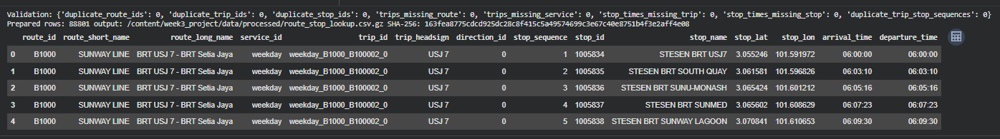

# Rapid KL Bus Data Quality Audit

Muhammad Ilham bin Mustafa Kamal   |   Matric ID: A24AI0058

## A. Project context

| Item | Details |
| --- | --- |
| Project title | Rapid KL Bus Route Assistant |
| Purpose | Prototype a source-grounded lookup assistant for new or occasional riders. It answers supported static-schedule questions about which routes serve a named stop and the ordered stops and scheduled times on a selected trip. |
| Two key requirements | 1) Join GTFS records and return route/stop/trip facts with source IDs. 2) Ask for clarification for ambiguous names and clearly refuse live-arrival or current-service claims. |
| Data sources and types | Prasarana Rapid Bus KL GTFS Static ZIP via data.gov.my, retrieved 18 Nov 2026. Structured CSV tables: routes, trips, stops, stop_times and calendar; also agency, shapes and frequencies. Licence recorded as CC BY 4.0. |
| Sample inspected | 20 stop-time records: two records from each of 10 route IDs selected at even intervals across the sorted route IDs; the selection used trip ID and stop sequence sorted as text. All 20 sampled records represent weekday trips. Full-feed structural and schema checks were also run. This is a small route-stratified sample, not a random estimate of whole-feed quality. |

## B. Data quality assessment

| Dimension | Finding and evidence | Impact |
| --- | --- | --- |
| Completeness | All required lookup keys and fields were populated: 0 blanks in required columns of routes (139), trips (2,118), stops (4,107) and stop_times (88,801). Optional fields are incomplete: trip_headsign is blank in 1,016/2,118 trips; stop_desc in 6/4,107 stops; stop_headsign in 41,783/88,801 rows. In the 20-row sample, trip_headsign was blank in 12 rows. | Do not depend on optional headsign/description text for core answers. |
| Consistency | All 88,801 stop_time rows joined to trip, route and stop records with no loss. Duplicate trip-stop sequence pairs: 0. Required foreign-key misses: 0 for trips-to-routes/services and stop_times-to-trips/stops. | Join integrity supports route-stop lookup for this snapshot. |
| Accuracy | All 20 sampled records matched the prepared lookup on trip ID, stop position, route ID, stop ID, stop name, arrival time and departure time. All stop coordinates are within legal latitude/longitude ranges; observed range is 2.745307-3.337331 N and 101.409016-101.909272 E. All arrival/departure values match GTFS HH:MM:SS syntax. This checks plausibility and internal structure only; no independent field survey or live operator source was used to verify actual locations/times. | Plausible data, but real-world correctness remains unverified. |
| Timeliness | Snapshot was retrieved 18 Nov 2026. Both weekday/weekend calendar services run from 2020-04-01 through 2027-03-31. The feed is static; the calendar range does not prove that a trip is operating today or that the schedule reflects disruptions. | Suitable for dated schedule lookup with a visible snapshot date; refresh before deployment. |
| Uniqueness | No duplicate route_id, trip_id or stop_id; no duplicate (trip_id, stop_sequence). However, 48 stop records share names with another record (24 duplicated names). | Use IDs as keys and clarify repeated stop names. |

## C. Validation rules and results

Applied to the archived snapshot retrieved on 18 Nov 2026. Results describe this file version; a refreshed feed must be checked again.

| Rule / problem | Measurable condition | Observed result | Action on failure |
| --- | --- | --- | --- |
| 1. Referential and key integrityDetect broken joins or duplicate keys that could return wrong route/stop associations. | Require unique route_id, trip_id, stop_id and unique (trip_id, stop_sequence); require every trip route/service and each stop_time trip/stop to resolve. | PASS. All duplicate and unresolved-reference counts were 0. Joined output retained all 88,801 stop_time rows. | Stop pipeline and quarantine affected rows for inspection; do not silently drop them. Review source IDs and schema changes, then rerun. |
| 2. Required fields and value formatDetect records the assistant cannot safely use and malformed schedules/coordinates. | Require non-empty lookup keys, stop name, coordinates, arrival/departure time; parse times as GTFS HH:MM:SS (allow hours above 23); latitude in [-90,90], longitude in [-180,180]. | PASS. 0 required-field blanks in the relevant full tables; 0 invalid time strings; 0 out-of-range coordinates among 4,107 stops. Note: 905 arrival and 905 departure values have hours above 23, which is valid GTFS service-day notation. | Quarantine invalid rows for human review. Check whether blank data is optional, a source defect, or a schema change before repair; do not auto-delete. Preserve >23-hour times as next-day service times. |

## Repeatability and provenance evidence

Two runs produced the same file, route_stop_lookup.csv.gz, with 88,801 records.
SHA-256  3a0591c3619a6e4d752621f26c4e03555f8d2e7a5c30416116c512effe746c51

## D. Coverage and potential bias

Two supported categories inspected: (1) BRT and local bus routes (the sampled route IDs include B1000 and S/T/U-series routes); (2) weekday and weekend service calendars. The feed contains both calendar categories and linked rows for sampled routes. This establishes that these categories exist in the snapshot, but the weekday-only sample cannot establish whether weekend stop orders and schedules are equally complete.

Potential bias: provider-reported operational omissions leave about 2% of Rapid Bus KL trips absent from stop_times.txt. If the assistant interprets missing records as “no service,” it could give false negatives and under-serve riders whose route/trip is among those omitted. The feed also has 24 duplicated stop names, which can cause unequal lookup accuracy when users provide names without IDs or locality. Investigate by comparing future snapshots with operator records and testing ambiguous-name queries; disclose coverage limits and ask clarification.

## E. Responsible data practices

The feed is publicly available GTFS Static data from Prasarana via data.gov.my, with retrieval timestamp, source URL, archive SHA-256, row counts and validation summary recorded. The inspected transit tables contain service, stop, route and schedule information, not rider profiles; this snapshot has no personal user records. Use it with CC BY 4.0 attribution, retain the source/version manifest, avoid collecting personal data in query logs, and keep logs anonymized. Refresh and revalidate the data, and label every answer as static scheduled information with its snapshot date.

## F. Engineering decision

| Item | Details |
| --- | --- |
| GO WITH CONDITIONS | Proceed to prototype integration for source-grounded static route/stop lookups only. Do not present the dataset as complete or real-time. The core table relationships and mandatory fields pass the checks above, while provider omissions, duplicated names, optional missing text and unverified operational accuracy require controls. |

## Priority improvements

1. Coverage and freshness guard: before each release, refresh the official feed; record retrieval date/hash; rerun schema, key, time, coordinate and row-count checks; check calendar validity; show an “as of” date and the provider’s approximately 2% missing-trip caveat. Add an explicit abstention for live arrivals, disruptions and unsupported services.

2. Ambiguity and grounding guard: index stops by stable stop_id plus name and coordinates; test duplicate-name prompts; ask the rider to choose when multiple stops match. Return the relevant route/trip/stop IDs and source snapshot, and never infer “no service” from an absent record.

## Appendix : Inspected Sample

| Route ID | Line | Position | Stop ID | Stop name | Arrival |
| --- | --- | --- | --- | --- | --- |
| B1000 | SUNWAY LINE | 1 | 1005840 | STESEN BRT SETIA JAYA | 06:15:00 |
| B1000 | SUNWAY LINE | 2 | 1005839 | STESEN BRT MENTARI | 06:17:41 |
| S0040 | AJ01 | 1 | 1003663 | AJ356 SK TAMAN MELAWATI | 06:29:00 |
| S0040 | AJ01 | 10 | 1001989 | AJ383 MEDAN SELERA AU5 (OPP) | 06:41:18 |
| S4050 | SA05 | 1 | 1000861 | SA947 GIANT SEKSYEN 13 | 06:00:00 |
| S4050 | SA05 | 10 | 1006772 | PANGSAPURI JAYA (OPP) | 06:15:30 |
| T3028 | T302 | 1 | 1000083 | AJ182 AMPANG POINT | 05:52:00 |
| T3028 | T302 | 10 | 1003562 | AJ64 SIMPANG LEMBAH JAYA | 06:06:21 |
| T6030 | T603 | 1 | 1006574 | SJ272 LRT PUCHONG PRIMA | 06:00:00 |
| T6030 | T603 | 10 | 1006583 | TAMAN PUCHONG TEKALI | 06:18:11 |
| T7650 | T765 | 1 | 1003094 | SA274 LRT SEKSYEN 7 PINTU B | 06:00:00 |
| T7650 | T765 | 10 | 1002456 | SA40 TASIK SEKSYEN 7 | 06:23:04 |
| U1510 | 151 | 1 | 1004342 | KL1821 PASAR SENI (PLATFORM A1 - A2) | 07:15:00 |
| U1510 | 151 | 10 | 1002694 | KL42 EDC HOTEL | 07:27:13 |
| U3000 | 300 | 1 | 1007445 | KL869 LRT/MRT MALURI PINTU D | 05:00:00 |
| U3000 | 300 | 10 | 1002689 | AJ133 PUTERI PARK PLAZA | 05:13:47 |
| U6510 | 651 | 1 | 1002606 | KL1360 LRT MUHIBBAH | 05:30:00 |
| U6510 | 651 | 10 | 1003901 | KL2151 TAMAN OUG (SELATAN) | 05:47:31 |
| U8518 | 851 | 1 | 1004342 | KL1821 PASAR SENI (PLATFORM A1 - A2) | 06:30:00 |
| U8518 | 851 | 10 | 1000313 | KL1915 DUTA VISTA (OPP) | 06:46:01 |

Source: Prasarana Malaysia Berhad via data.gov.my, Rapid Bus KL static GTFS snapshot, 18 November 2026 (CC BY 4.0).

## Supporting evidence

Colab prepared 88,801 rows with no duplicate keys or missing references in the checks shown.

Both Colab runs produced the same output file and matching validation results.

Dataset Link: https://api.data.gov.my/gtfs-static/prasarana?category=rapid-bus-kl

