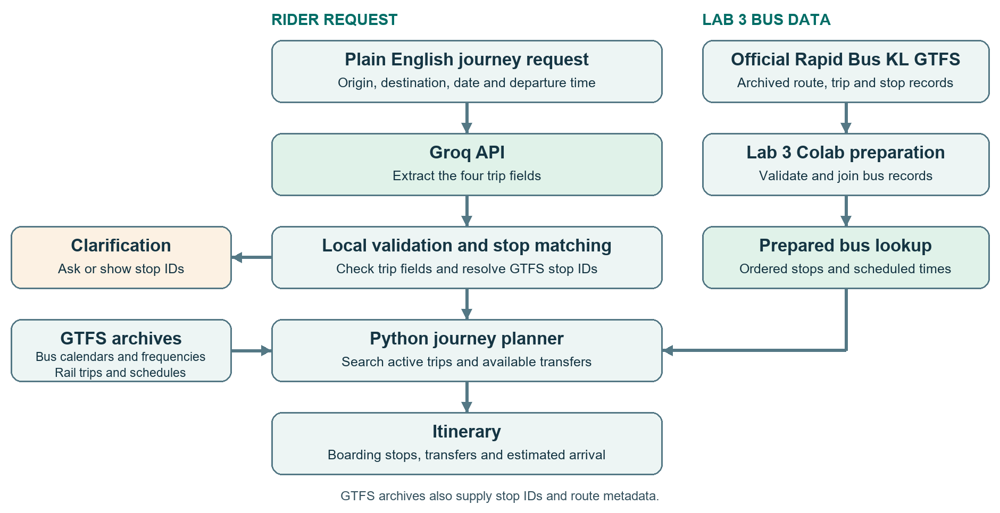

# Rapid KL Journey Planner

This is a local Python prototype for planning a stop-to-stop trip from a chosen departure time. It shows each route, boarding stop, transfer and estimated or scheduled arrival. It uses Python 3.10 or newer and requires no third-party packages.

Run this from the RapidKL project folder for interactive prompts:

```powershell
python journey-planner/plan.py
```

Or run the archived Maluri to Pasar Seni example:

```powershell
python journey-planner/plan.py bus:1007445 bus:1004342 2026-11-23 05:00
```

The planner accepts exact stop names, partial names and prefixed stop IDs. An ambiguous name prompts for a stop ID in interactive mode. Departure times use Kuala Lumpur local time. By default, routing searches up to four rides over the next 24 hours from the requested departure and allows three minutes between rides at a shared stop. The trip limit can be adjusted with `--max-rides`.

## Plain-English questions

Set `GROQ_API_KEY` in your environment. The question is sent to Groq for parsing, and the local planner resolves stop names and calculates the itinerary using the archived data.

```powershell
python journey-planner/plan.py --ask "How do I get from Maluri Pintu D to KL1821 Pasar Seni after 5 a.m. on 23 November 2026?"
```

Use a specific stop code or the suggested stop ID if a name is ambiguous. The default model is `openai/gpt-oss-20b`. If your Groq account has Enterprise access to Llama 3.3, set `GROQ_MODEL` to `llama-3.3-70b-versatile`. [Groq supported models](https://console.groq.com/docs/models)

## Transfers and estimates



Groq extracts the trip fields. For bus journeys, the local planner reads the Lab 3 Colab lookup for the ordered stops and their arrival and departure times. The matching bus GTFS archive supplies the service calendars, departure frequencies and route metadata. Rail journeys use the rail GTFS archive.

The planner can transfer between rides that share a stop ID within the same feed. To add a verified walking connection, pass `--transfers path/to/links.csv`. Use these columns: `from_stop_id,to_stop_id,walk_seconds,evidence`. Each link is directional. Use the prefixed IDs reported by the planner, record the source for the connection and add the reverse direction separately if it has been verified.

The two archived feeds do not establish walking connections between distinct stop IDs. Since no verified link file is included, the prototype can currently miss routes that need a walk between stops, including Setia Jaya to Maluri. An empty result describes coverage in the planner and does not establish that travel is impossible.

Frequency-based services use a regular departure grid calculated from the GTFS headway periods. Times involving these services are estimates and connections may differ in practice. The planner applies archived GTFS service calendars and date exceptions. Use the archived dates for coursework demonstrations and check official service information for actual travel.

## Data

Prasarana Malaysia Berhad via the Malaysia Open Data GTFS Static API, archived on 18 November 2026, CC BY 4.0. Use the matching GTFS archives in `data/raw/` and the Lab 3 lookup at `data/processed/route_stop_lookup.csv.gz`. The standalone local copy keeps all three files in `journey-planner/data/`. [Official GTFS documentation](https://developer.data.gov.my/realtime-api/gtfs-static) · [Project archive](https://github.com/muhdilham1602-max/ai-engineering-RapidKLAssistant/tree/48266e047d4ffe10c13f9a4e36a443919f0300de/data/raw)
